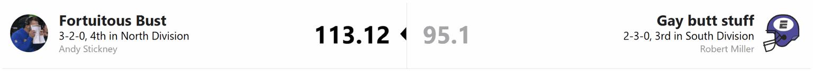
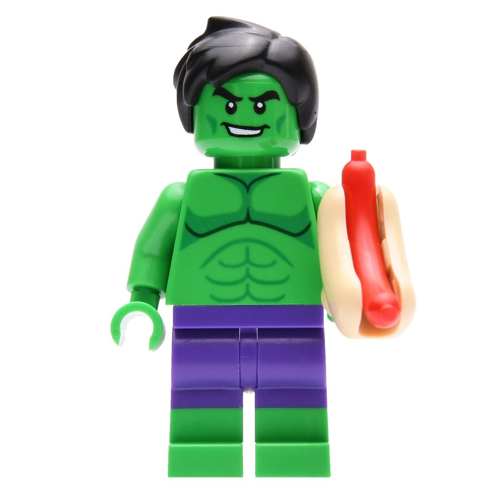
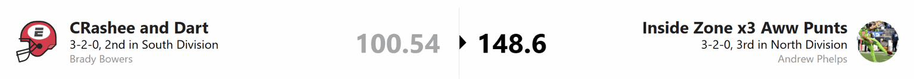
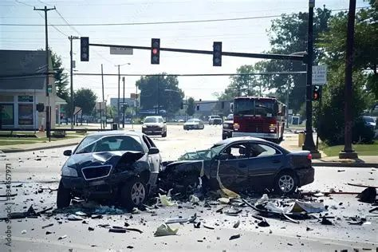
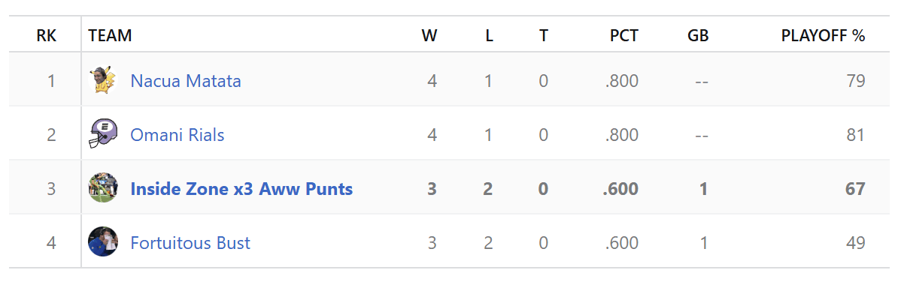
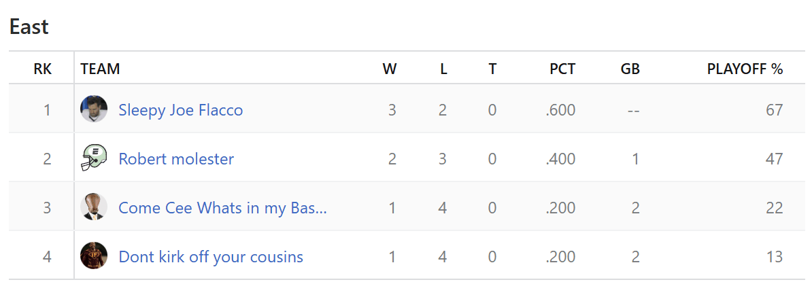
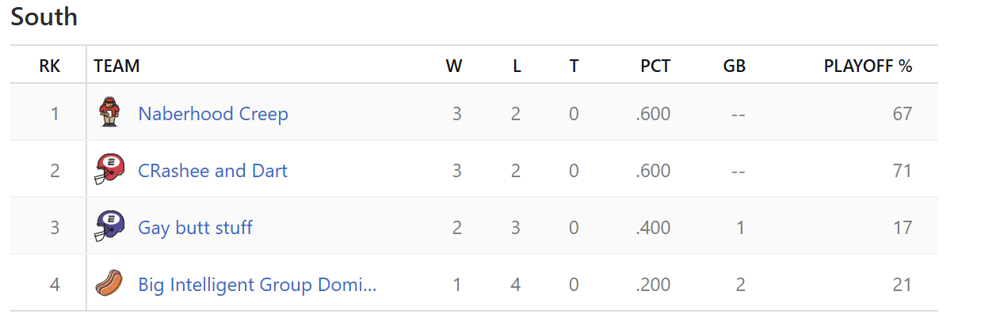

# WEEK 5 RECAP

Five weeks down, and the league is starting to take shape. We also have a league website now, so congratulations to Logan for giving us a more official place to document everyone’s bad decisions.

Onto the games.

## THE BUSTS VS. GAY BUTT STUFF

Andy’s collection of Busts got the win, but this was hardly a display of offensive brilliance. Ethan got good games from Braelon Allen and Drake London. Unfortunately, the rest of his roster seemed to think those two had everything covered.

The Busts weren’t much better. Matthew Stafford, J.K. Dobbins, and Brenton Strange were fine, while the rest of Andy’s lineup settled comfortably into “meh.”

So what made the difference?

THE KICKER.

Sixteen points from a kicker won Andy a fantasy matchup. All that time researching trades and building a roster, and the deciding factor was a guy who showed up, kicked a ball a few times, and went home.

## THE CREEPS VS. THE KIRK OFFS

Don’t look now, but Whieldon is in first place in the South.

The Creeps put together another solid week. They may not have the flashiest roster, but enough players keep doing their jobs that Whieldon is moving farther and farther away from **THE CHIP**.

James, meanwhile, got one good performance from Jayden Daniels and very little help from anybody else. The Kirk Offs are injured, struggling, and running out of ways to call this a temporary problem.

If that roster doesn’t get healthy soon, James may want to start building his spice tolerance. **THE CHIP** is beginning to look less like a threat and more like a dinner reservation.

## PUKA-CHU VS. THE MOLESTOR OF ROBERT

HOLY POINTS, BATMAN.

Puka-Chu scored 204 points.

Jaylen Warren, Puka himself, Brock Bowers, and Jared Goff all went off. It was the kind of week where Landon could open his fantasy app, look at almost any player, and say, “Oh, you too?”

Matt’s team happened to be on the other side, but it barely mattered what they scored. They were background characters in the opening scene of Puka-Chu: The Movie, included mostly to demonstrate what happens when the electric mouse gets angry.

Landon might wish he could save some of those points for a closer game. Fantasy football, unfortunately, does not offer store credit.

## HOT DOG MAN VS. THE SLEEPY JOES

Dillon won a game.

I repeat: DILLON WON A GAME.

With that, “Hot Dog Piss” has been retired, at least for now. He gets his old name back. In fact, after this performance, we can briefly call him the Incredible Dog.

Bucky Irving finally did something, and the rest of Dillon’s lineup pulled its weight. After four weeks of watching the roster struggle, it turns out there was a functioning team in there somewhere.

The Sleepy Joes weren’t awful. They were just a little too sleepy. Logan put up a respectable performance, but Dillon picked this week to wake up and take the win.

Enjoy the new name, Dillon. Its continued use depends on continued results.

## THE BREAD MAXERS VS. ROBERT THE EMPTY-MINDED

SOUND THE ALARMS.

ROBERT LOST AGAIN.

I REPEAT: ROBERT LOST AGAIN.

It was a low-scoring game, and neither roster should leave feeling especially proud. Max got the win, which is what matters, but his 4-1 record may be hiding a problem.

The Bread Maxers are producing wins without always looking convincing. There might be a little mold growing beneath that perfect-looking loaf.

Robert has an even bigger concern: his alleged black magic appears to have expired. Somebody check whether the warranty covers a losing record.

## THE CRASH OUTS VS. THE PUNTERS

Brady started 3-0. Now he has lost two straight and surrendered first place in the South to the Creeps.

The Crash Outs may need to update their name again, because lately it has been less of a joke and more of a weekly description.

As for the Punters, the points keep coming from both expected and unexpected places. Every time I think I know which players will carry my lineup, somebody else shows up. I am not going to question it. I have spent enough time this season losing while scoring a ton of points, so I’ll happily accept a win however it arrives.

## Standing Analysis

### The North

Who decided to put every competent team in the North?

The division has both 4-1 teams, and nobody is below .500. Outside of Andy, practically everyone here could be leading another division. Every week feels like a playoff matchup, which is excellent for entertainment and terrible for my blood pressure.

This is exactly the kind of scheduling luck I should have expected.

### The East

Logan’s dad nap has not hurt him much, partly because the Sleepy Joes are sharing a division with three teams that have not consistently scared anybody.

It has the energy of the old AFC East: one team acting like the Patriots while everybody else argues about which of them is least disappointing.

Logan should enjoy it. Some of us have to play in the North.

### The South

Whieldon takes over first place after Brady’s second straight loss. The Creeps are doing enough to win, while the Crash Outs suddenly have something to prove.

Dillon also showed signs of life this week. Was it the beginning of a comeback or one glorious hot dog–shaped fluke? We’ll find out soon.

That’s Week 5. See you next week, when Robert will presumably insist his magic is “just taking a bye.”
