# WEEK 6 RECAP

AUBURN BEAT GEORGIA BETWEEN THE HEDGES.

I don’t even care that the Seahawks lost. Auburn won. We are so back.

Unfortunately, this is a fantasy football recap, so I am required to stop celebrating long enough to make fun of all of you.

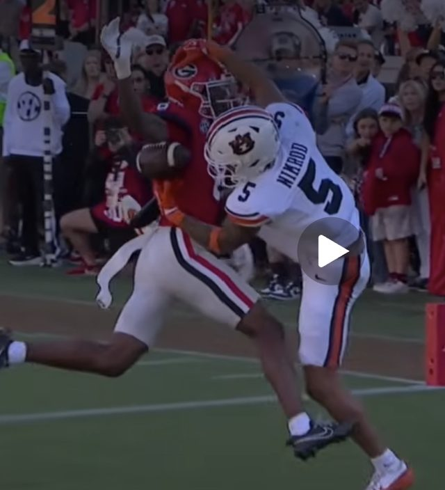

## HOT DOG WATER VS. ETHAN

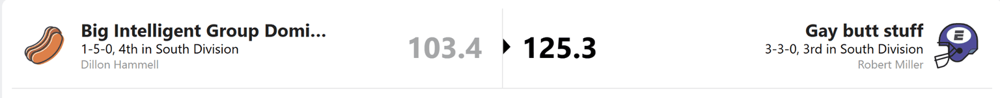

How is Ethan 3-3?

His team has looked terrible for much of the season, yet somehow his record is sitting at .500. Playing in the South and drawing several East teams certainly helps.

Kyle Pitts scored a lot of points this week, which was surprising enough that I checked to make sure I had opened the right matchup. Cam Skatteboe, meanwhile, scored nothing. Ethan’s quarterback options are not exactly inspiring, and his injured reserve list includes Achane and another player who cannot help him right now.

The waiver wire has been thin at running back outside of Ollie Gordon. Ethan may be 3-3, but keeping that record above water will take some work.

Dillon’s team is easier to explain. Most of his players aren’t wildly underperforming. They are doing roughly what you would expect, which is the problem, for many of them, you don’t expect much.

Hot Dog Water could absolutely go off in the toilet bowl and ruin somebody’s season. I just wouldn’t bet on it happening often.

## PUKA-CHU VS. THE CREEPS

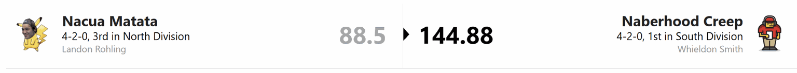

Puka-Chu is about as consistent as a road covered in potholes. One week, Landon scores enough points to defeat a small country. Next, the electric mouse needs somebody to push start him.

That does not take anything away from Whieldon. The Creeps put up a strong score in the 140s and earned the win.

The concern is quarterback. Whieldon has four of them on his roster, no dependable starter, and questions about whether one of those four will even play again this season. Having that many quarterbacks and still needing one is an impressive logistical failure.

He may now be hoping to land J.J. McCarthy just to get acceptable production. That is a sentence nobody wants to say out loud.

The rest of the roster has a solid core, James Cook, Zay Flowers, Malik Nabers, Dalton Kincaid, Brown, and Aaron Jones. The Creeps can keep winning, but doing it without steady quarterback play will be a weekly adventure.

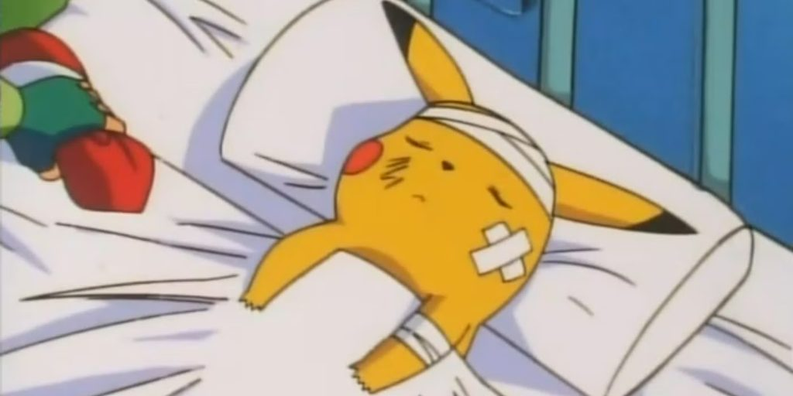

## THE KIRK OFFS VS. THE CRASH OUTS

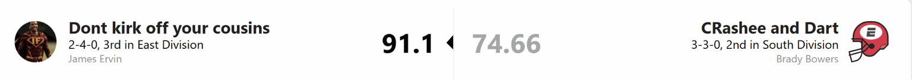

The Crash Outs are officially living up to their name.

Brady started 3-0 with a playoff probability above 70%. Three straight losses later, he is back at .500, and his roster looks like it could open its own urgent care clinic.

Davante Adams is on IR. Quinshon Judkins left early and put up a zero. Even Bijan had a bad game. At some point, there are only so many injuries a roster can absorb before “wait until everyone gets healthy” becomes the entire strategy.

Brady may look much stronger later in the season. The question is whether he can stay in the playoff race until then. He faces Whieldon again next week, and another loss would make the South much harder to reclaim.

As for James and the Kirk Offs you won.

I watched the performance, and I think that is enough praise for one week.

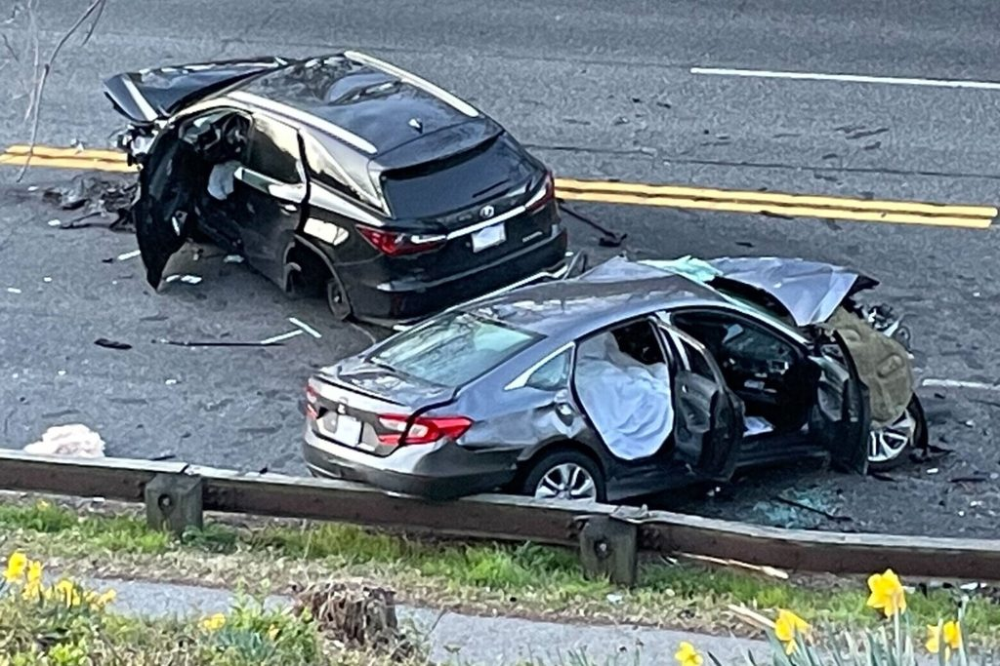

## THE BUSTS VS. SLEEPY JOE

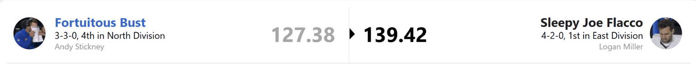

Fee-fi-fo-fum. Sleepy Joe has finally awakened.

This matchup also gave Andy another chance to think about the Ja’Marr Chase trade, which is probably not how he wanted to spend his Sunday.

Chase was on a bye, so he would not have helped Andy this week. Unfortunately, the players Andy received were not much help either. A.J. Brown returned, then promptly got hurt again, and Travis Etienne is still on IR. It is hard to enjoy the extra depth from a trade when most of that depth is in the medical tent.

Andy still has a good team and currently holds the third wild card spot despite sitting third in the North. But having a top receiver would make that position a lot more comfortable.

He also left DK Metcalf on the bench in favor of Tyler Allgeier. I understand being skeptical of DK, but choosing a backup running back and hoping for the best is a bold way to test fate. Starting DK would have won Andy the game.

Logan, meanwhile, won without big games from Amon-Ra St. Brown or Ja’Marr Chase. Tuten, Smith, and a player named Germaine Bernard stepped up instead. I had to check who Bernard was, but apparently Logan knew something the rest of us didn’t.

Logan also has three quarterbacks. Whieldon desperately needs one. Logan, you know what to do, negotiate like a man selling water in the desert, get yourself a reliable running back, and make the Sleepy Joes even scarier.

## ROBERT THE HOLLOW SKULL VS. THE ROBERT MOLESTORS

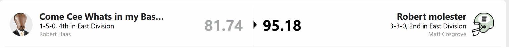

Robert, what is going on inside that enormous head?

Your running backs are Omarion Hampton and Kenny Gainwell, and lately that combination has been producing the sort of total that makes you check whether both players actually started. CeeDee Lamb has been up and down, and Garrett Wilson has not given you the dependable receiver production you need.

The famous Robert magic appears to be on an extended vacation.

Matt’s Molestors have their own problems. Jahmyr Gibbs was on a bye, so some disappointment was expected, but this roster continues to look better on paper than it does on Sunday. The Molesters are 3-3, and somehow that record feels both fair and confusing.

Lamar should be healthy soon, and Gibbs will return. That gives Matt a path forward. Right now, though, this looks like a team that can avoid **THE CHIP** without convincing anybody it can win the championship.

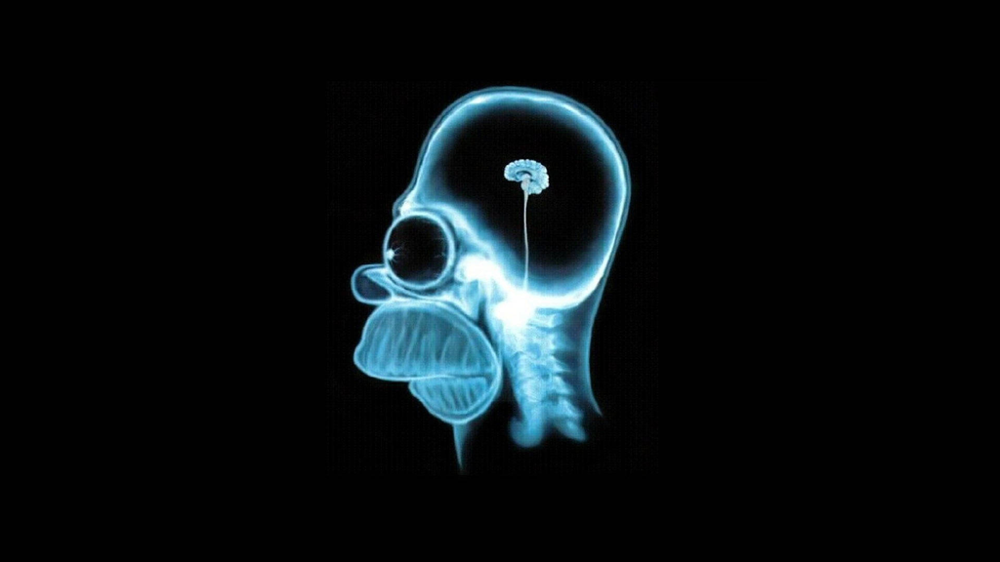

## The Punters vs. The Bread Maxers

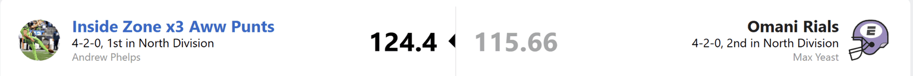

Um, guys?

How am I in first place?

I have stars. Kyren and Chuba are both averaging close to 20 points a game. Josh Allen is still Josh Allen, even if he saves most of his damage for a few huge weeks. JSN is practically a set and forget 20 points, and Isaiah Likely has been excellent.

Then there’s my WR2 and flex situation, which resembles a rotating exhibit of disappointment.

Jaylen Waddle has done almost nothing outside of one game. Tony Pollard is stuck trying to produce in the Tennessee offense. Jakobi Meyers is inconsistent. Romeo Doubs is on IR. Jordan Addison has been hurt and unpredictable.

I’m hoping Alec Pierce can take Waddle’s spot and Jadarian Price can eventually rescue me from the Pollard experience. That is a lot of hope to place in two players, especially before the inevitable injuries arrive.

But for now, I’m number one. I will worry about the structural integrity of this team after I finish enjoying that.

Max put up a valiant fight behind CMC, DeVonta Smith, and Keenan Allen. Derrick Henry, of all people, delivered a stinker and helped drag the Bread Maxers down. Max is still having a great season, but both of his losses have now come against the Punters.

My schedule gets a little friendlier over the next few weeks, with two South teams coming up. After the North’s opening stretch, I think I’ve earned a break.

## STANDINGS ANALYSIS

### THE NORTH

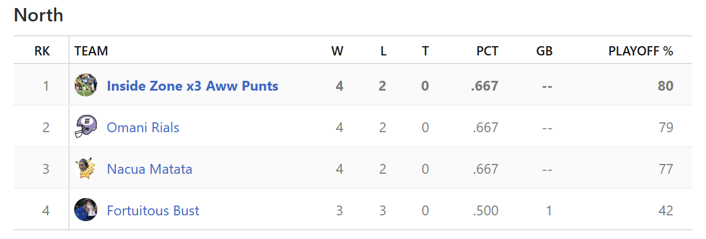

Thank you to everyone else in the North for losing while I won my third straight game.

The Punters move into first place, but this division is still nasty. Every North team is currently projected to make the playoffs. That may not last, I have already played one more division game than most of the other North teams, so we still have plenty of chances to knock each other down.

Whoever misses the playoffs could enter the consolation bracket as its most overqualified contestant.

### THE SOUTH

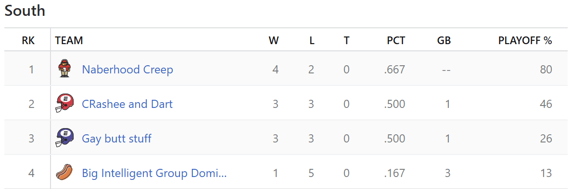

I could call this a competitive division if the Crash Outs had not lost three straight.

The Creeps have a chance to bury Brady a little deeper next week. Ethan is the least convincing 3-3 team I have ever seen. Dillon is still Hot Dog Water, with the name change from last week now looking increasingly premature.

Whieldon has the lead. Whether his quarterbacks let him keep it is another question.

### East

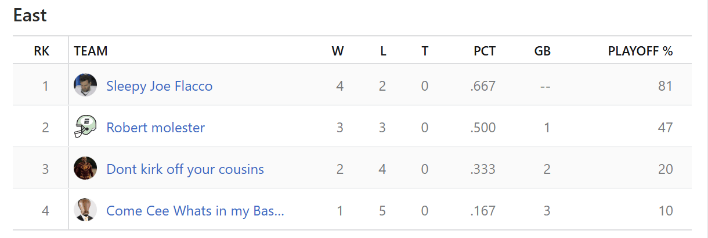

Logan should have this division on cruise control. If the Sleepy Joes had taken care of business over the last two weeks, we might already be discussing who finishes second.

Instead, the Robert Molestors are only one game behind. The division is still open, even if Logan has the roster I would trust most.

As for Robert and James, I recommend developing a tolerance for spicy food. **THE CHIP** is no longer a distant rumor.

## CURRENT PLAYOFF BRACKET

New this week we are far enough into the season to start looking at the playoff bracket.

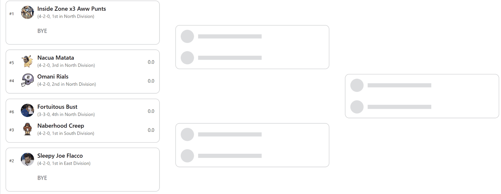

Right now, the Punters and Sleepy Joes have the byes. The Punters hold the number one seed thanks to leading the league in points scored.

One wild card matchup would be an all North fight. The other would pit the Creeps against the Busts.

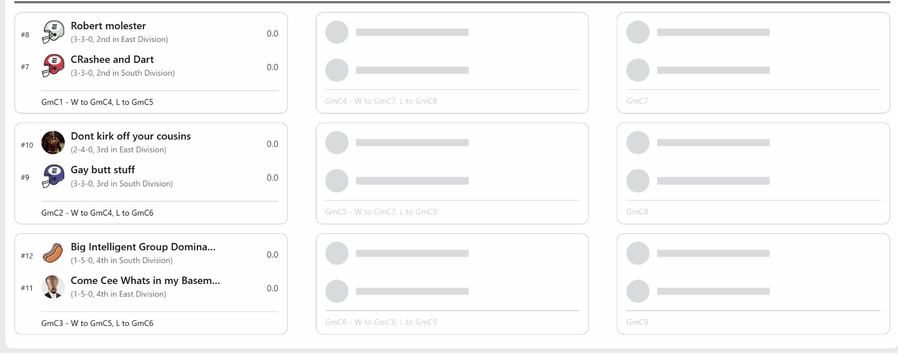

In the consolation bracket, Brady and Matt look relatively safe from THE CHIP for now, though Brady has already shown he is capable of a three game slide. Dillon and Robert currently have the clearest path to the punishment nobody wants.

That’s Week 6. Auburn beat Georgia, I’m in first place, and Robert might have to eat **THE CHIP**. Overall there have been worse weeks.
