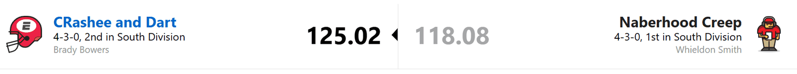
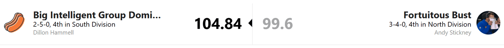
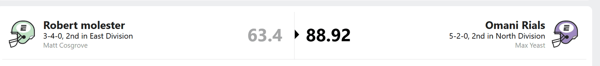
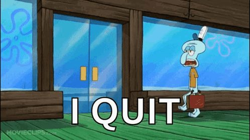
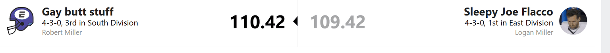
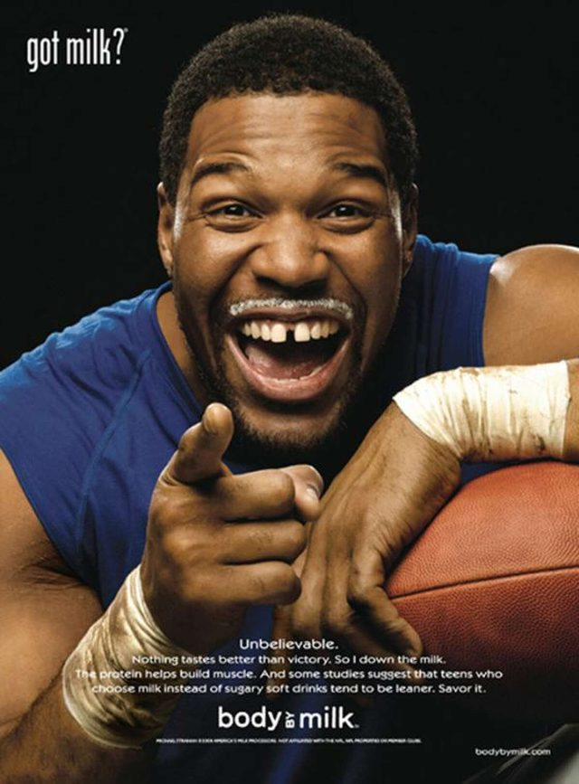

# WEEK 7 RECAP

I am exhausted. Classes have been beating my ass all week, but I will still deliver THE RECAP.

Unfortunately, this edition is being written on minimum sleep and whatever brain activity I have left. After looking at this week’s matchups, most of your teams appear to be operating under the same conditions.

## THE CRASH OUTS VS. THE CREEPS

Brady narrowly avoided turning a three-game losing streak into a full divisional crisis.

A loss would have put the Crash Outs two games behind Whieldon. Instead, they are tied for the lead, thanks to strong performances from Trey McBride, Quinshon Judkins, and Emmanuel Wilson.

The Creeps got good games from Bo Nix and Zay Flowers, but not enough help from the rest of the roster. This will be a theme throughout the recap: three or four players do something useful while everybody else watches.

Brady desperately needed this win. Whieldon probably would have preferred that he stayed asleep for another week.

Given the division they play in, both could still make the playoffs. The South continues to offer a generous rewards program for being moderately competent.

## HOT DOG WATER VS. ASS OR BUSTS

Andy’s big trade continues to provide excellent material for these recaps and very little help for his lineup.

A.J. Brown scored 7.8 points, Etienne remains on IR, and the rest of the Busts apparently decided Andy had not suffered enough.

K9, usually one of his dependable players, got swallowed by Seattle’s Dark Side defense. Everybody else offered roughly the level of support you would expect from a folding chair with three legs.

Dillon won behind Drake Maye, Bucky Irving, and Jonathan Taylor. The rest of his roster remains a collection of names you look at and say, “Surely there’s somebody on waivers.”

Dillon may be hoping Taylor gets traded out of the Colts’ fire sale, and he probably cannot count on the same Bucs nonsense producing a big game for Bucky every week. He needs more dependable contributors if he wants to keep winning.

For Andy, winning alone may not be enough. He also needs points to improve his position in the tiebreakers. The North is technically still within reach, though I understand if looking at the standings makes it feel like another country.

Stay near .500, find some points, and maybe the Busts can finally get into the playoffs. Preferably with players who are available outside visiting hours.

## EYE ASSAULT VS. THE BREAD MAXERS

f there was ever a game nobody deserved to win, it was this one.

Both teams played somebody who did not even start his actual game.

I am exhausted, and even I managed to open the app. If you are not going to put effort into managing your teams, I am not putting effort into writing about them.

Next.

## LOGAN THE CHOKER FLACCO VS. ETHAN

What was this week?

Logan had all three of his usual Jaguars starters on bye, which explains part of the problem. Apparently, constructing an entire fantasy ecosystem around Jacksonville has seasonal consequences.

Still, Ethan won again.

How?

How are THREE teams in the South now 4-3? I look at some of these rosters and expect a rebuilding project, then check the standings and find a playoff contender.

Ethan keeps collecting wins while I keep explaining why he should not be winning. At some point, one of us has to adjust, and I refuse to let it be me.

## ROBERT THE FALLEN VS. PUKA-CHU

Rejoice. Robert’s reign of evil appears to be over.

The black magic is gone. The voodoo dolls have been repossessed. With one win, Robert has officially moved into the basement and appears to be assembling furniture.

His team is injured, waiver replacements are hard to find, and even getting players back may not be enough to rescue the season.

Robert must be wondering why he spent all his good fortune before THE CHIP became the punishment. He could have paid off his bad karma in a cheaper year. Instead, the bill has arrived with interest and a warning label.

Landon, you did enough to win. Congratulations on completing this week’s community service.

## The Punters Vs. The Kirkoffs

Sometimes I hate fantasy football.

If I had the guts to start Cooper which I bowed out on at the last minute, I would have won. Instead, I got to watch the points sit on my bench while my actual lineup lost to James.

After weeks of making fun of everybody else’s lineup decisions, I have thoughtfully provided an example of my own.

You’re welcome.

The Kirk Offs got the win, and I got another reason to stare at my roster in silence.

That’s Week 7. I need sleep, Andy needs points, and Robert needs milk. Why milk who knows I thought it sounded funny.

