# WEEKS 8 AND 9 RECAP

Welcome to the double recap. We’ve got twelve matchups to get through, so I’ll keep these brief. Some of you kept your scoring brief, too. I appreciate the teamwork.

## WEEK 8

### THE CREEPS VS. THE BREAD MAXERS

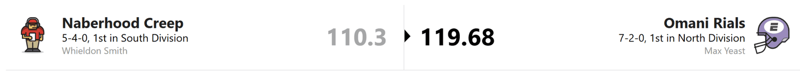

Max started two injured players and won anyway. Joe Burrow and Tee Higgins apparently looked around, realized nobody else was coming, and handled the matchup themselves.

Zay Flowers actually played and still gave Whieldon a zero after both Lamar Jackson and Tyler Huntley got hurt in the same game. Imagine watching both quarterbacks go down and realizing the two injured guys in Max’s lineup are doing exactly as much for him as Flowers is doing for you.

The Bread Maxers survived CMC’s bye, but we’re getting down to the heel of the loaf on that bench.

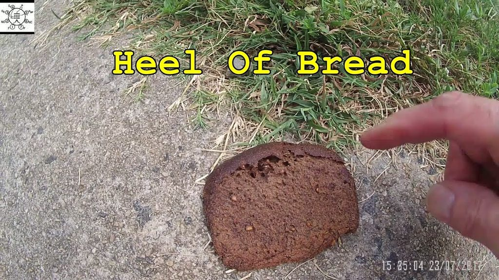

### PUKA-CHU VS. THE BUSTS

Puka-Chu beat Andy again, and Puka, Brock Bowers, and Jaylen Warren could have just about done it by themselves. Landon brought a whole lineup out of courtesy.

Andy is falling out of the division race. A.J. Brown still isn’t contributing much, Travis Etienne is still on IR, and K9 has revealed that he is, in fact, mortal. When K9 and Chris Olave aren’t carrying the team, the Busts really commit to the name.

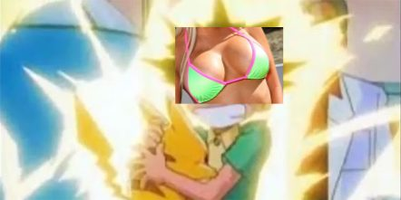

### ROBERT MOLESTOR VS. THE CRASH OUTS

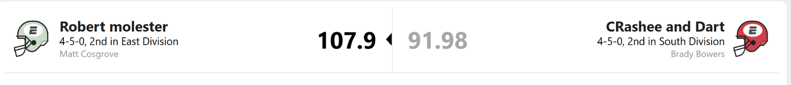

Remember when Brady looked like a lock to win the South? The Crash Outs are now trying to sneak into the playoffs without anybody asking for ID.

The roster needs more firepower and more consistency. Getting some players back from injury could still give Brady a chance to reclaim the division, so I’m holding off on the funeral.

As for Matt, I’m still trying to figure out how this team keeps getting away with it. Congrats, though. The standings don’t ask for an explanation.

### THE SLEEPY JOES VS. THE KIRK OFFS

Every week, James and the rest of us have to guess whether Logan’s team is asleep or about to jump out of bed and score all over somebody.

Bad news, James. Joe was awake.

Ja’Marr Chase, Bhayshul Tuten, and D’Andre Swift had big games, and the rest of the lineup did enough to make sure James never got comfortable. The Kirk Offs can now return to their regularly scheduled programming: checking how close they are to the toilet bowl and building his spice tolerance for the possibility of **THE CHIP**.

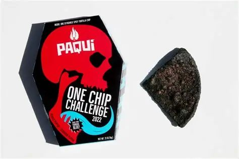

### ETHAN VS. ROBERT THE INSUFFERABLE

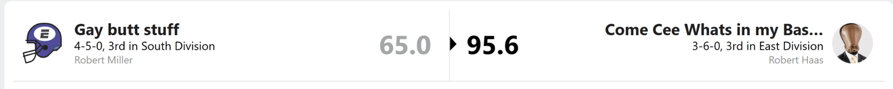

Robert insists this win is the start of his big comeback.

I looked at the matchup. It was ass.

That concludes our coverage of Robert’s big comeback.

### THE PUNTERS VS. THE SOMEWHAT DECENT HOT DOG

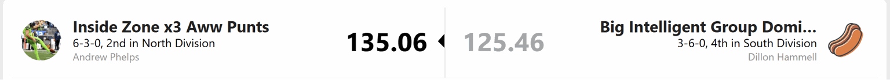

Dillon put up a respectable fight. Josh Allen, JSN, Tony Pollard, and Chuba Hubbard gave me enough to get the win, but I’m almost more excited about my bench. I have four perfectly okay wide receivers, which means I can spend all week deciding which one to start and still pick the wrong guy.

Anyway, Dillon might have a run in him. If Whieldon gets too comfortable, the Somewhat Decent Hot Dog could become a real problem.

## WEEK 9

### WATCH OUT FOR THE DOGS VS. THE CRASH OUTS

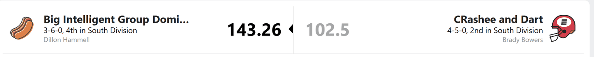

For the second straight week, Brady drove the Crash Outs directly into a wall. Bijan was the only one who managed to get out of the car. I imagine the locker room was pretty quiet after this one.

Dillon, meanwhile, scored the most points in the league. Remember when I was calling this man Hot Dog Water?

Losing Josh Jacobs again just two weeks after getting him back sucks, but Dillon still has Bucky Irving and Jonathan Taylor. Christian Watson and Nico Collins are a good receiver pairing, too. The rest of the schedule looks manageable enough that I wouldn’t be surprised if he won out and made the playoffs.

If that happens, please delete all previous recaps.

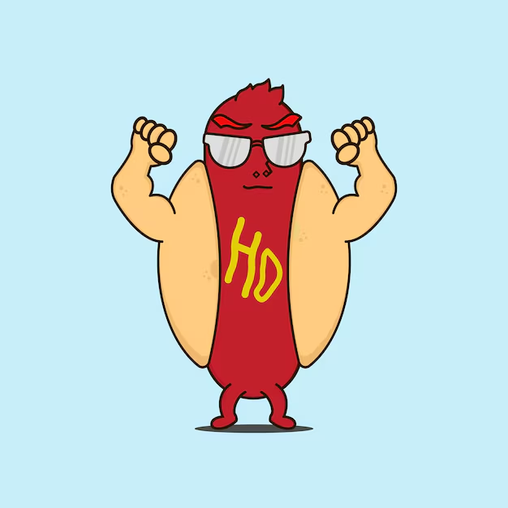

### PUKA-CHU VS. THE BREAD MAXERS

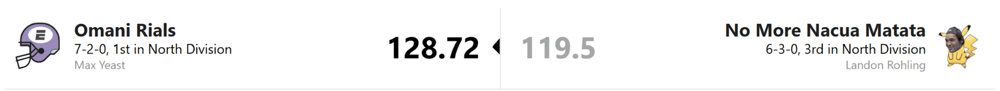

If you saw Landon’s official team name and wondered what happened, yes, it’s true: Puka-Chu himself is out of action. That’s a brutal hit to both the roster and the plot armor. I’ve seen the backup options, and I would like the plot armor back, please.

Max is still maxing bread. CMC, Joe Burrow, and Tee Higgins are doing the heavy lifting. Derrick Henry’s production is worrying with so little threat from the passing game, Rhamondre Stevenson is hurt, and Max is still sending out the fossil of Keenan Allen.

The top of the lineup is good enough to win a lot of games. I’d just prefer not to find out what the bottom looks like without it.

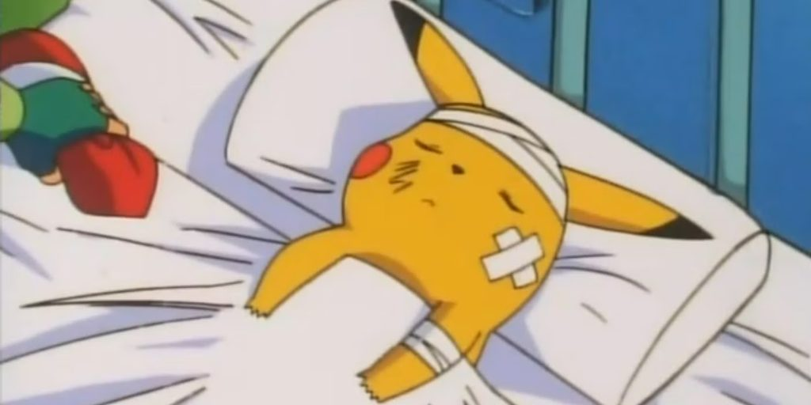

### THE BUSTS VS. ROBERT MOLESTOR

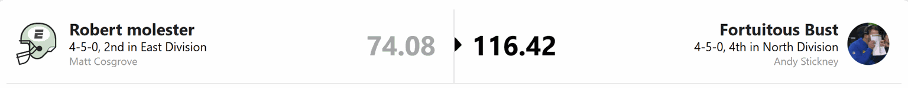

Andy’s playoff hopes are currently being held together by K9 and the phrase “when everybody gets healthy.”

Luther Burden is starting to look like a useful piece, but Andy needs A.J. Brown and Travis Etienne back and producing soon. Otherwise, he may be booking another trip to the consolation bracket. At this point they ought to give him a loyalty card.

As for Matt, I don’t have much to say.

### WAKE THE F*** UP, JOE VS. THE CREEPS

Logan should be running away with the East. Instead, the Sleepy Joes keep hitting snooze. Ja’Marr was about the only guy who lived up to the hype this week, and there’s only so much one receiver can do while the rest of the lineup is still in bed.

I still expect Logan to make the playoffs. I would feel better about picking him to win if I knew which version of his team was going to show up.

Whieldon keeps the ship steady and should make the playoffs, too. The question is whether the Creeps can beat more talented rosters several weeks in a row. Eventually, somebody is going to make them score enough to find out.

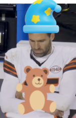

### OH NO, ROBERT HAS AWAKENED VS. HIS VICTIM

Robert has now won two games with scores that had no business winning.

Is this the fabled Trash Time?

I would like to formally retract last week’s conclusion. His big comeback now has two exhibits, and both smell like garbage.

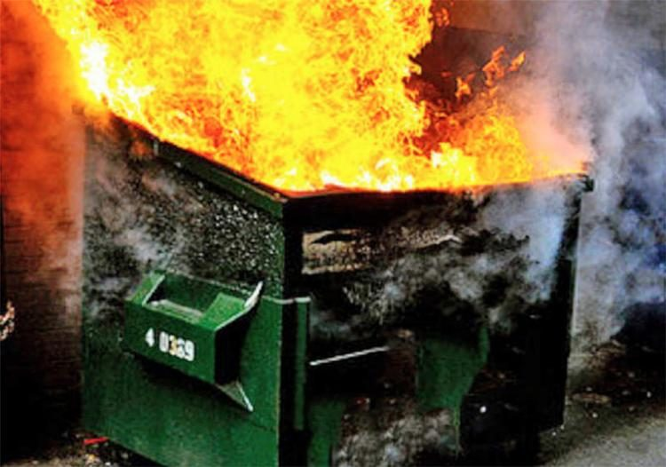

### THE PUNTERS VS. ETHAN

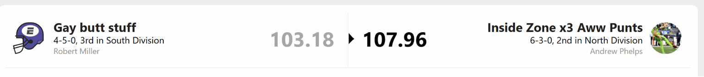

I eked out the win despite several of my players having forgettable games and, as promised, starting the wrong WR2 again. Four okay receivers. Plenty of choices. Same result.

I don’t expect to get away with that very often, so I’ll happily take the win. As for Ethan, his fantasy team goes as the Falcons go. This week, the Falcons went nowhere, and Ethan went right along with them.

## STANDINGS ANALYSIS

### THE NORTH

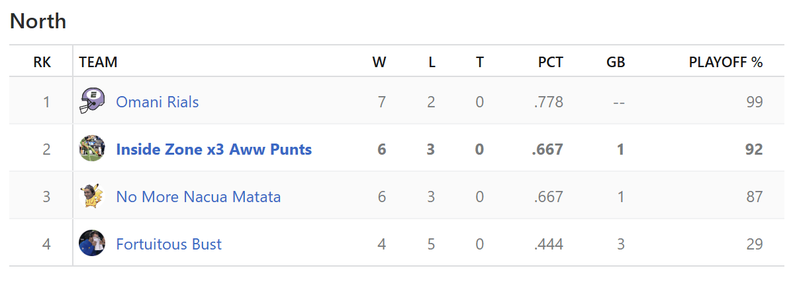

We’re hogging the wins. Every wild card currently comes out of the North, and one side of the playoff bracket could end up looking like we never left divisional play.

If Puka were healthy, I’d argue the North had the three best teams in the league. Sorry, Andy. You really picked the wrong division to have a perfectly reasonable playoff race in.

### THE EAST

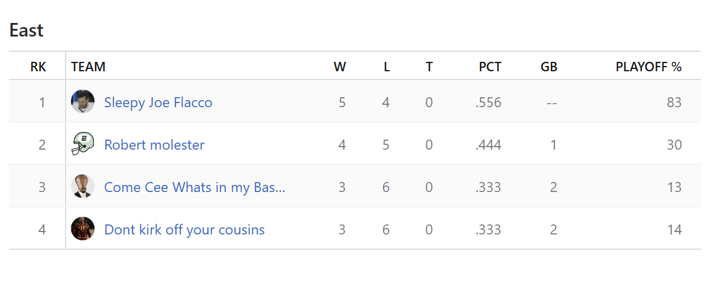

Logan should be something like 7-2 and halfway to clinching by now. Instead, Robert, who has spent most of the year playing like ass, is only two games back.

Everyone in the North would like to file a transfer request.

### THE SOUTH

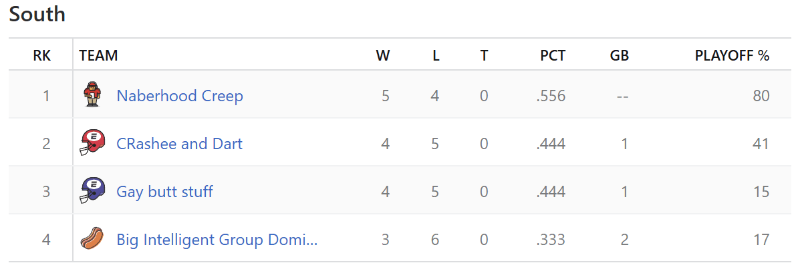

The funniest thing about the South is that its best roster right now might belong to the guy at the bottom. Dillon looks dangerous, but he still needs a big run to get into the playoffs.

The Creeps are in a much better spot. Whieldon probably just needs to keep being decent and make Dillon do all the work of catching up. That has basically been the Creeps’ entire strategy, so I see no reason to change it now.

## PLAYOFF PREVIEW

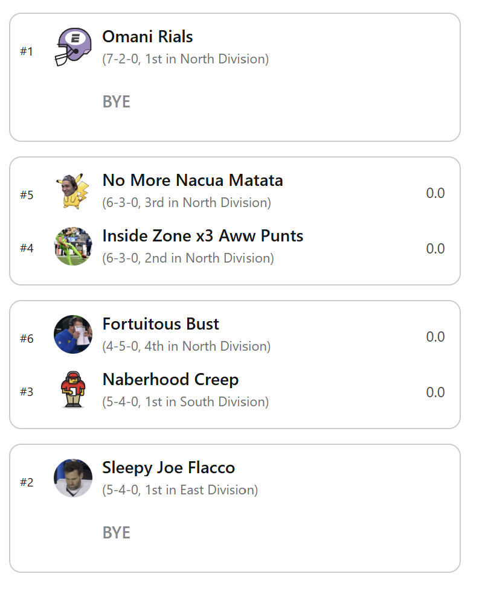

As it stands, Max is getting a North opponent either way. If Andy beats Whieldon, Andy plays Max. If Whieldon wins, Max gets the winner of the all-North wild-card matchup. We really could’ve saved ourselves some time and called this the North Invitational.

Logan however has a bye and with the consistency of his team that is probably for the best.
